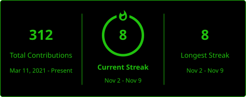

# Hey, I'm Sasmitha 👋

### AI & Data Engineering Undergraduate | Machine Learning | Data Engineering | Automation

I'm an **AI and Data Engineering undergraduate** passionate about turning messy, real-world problems into practical solutions through machine learning, data engineering, and software development.

My interests lie at the intersection of **data, intelligent systems, and software engineering** — building pipelines that transform raw data into meaningful insights, developing models that learn from data, and creating automation tools that make complex processes more efficient.

I value practical engineering over hype: writing clean, reliable code, exploring new technologies, and building solutions that work beyond the prototype.

### 🛠️ Tech Stack

**Programming Languages & Web Technologies**

**AI, Machine Learning & Data Science**
Pytorch • Scikitlearn • Numpy • Pandas • Cuda • Tensorflow • Polars • Seaborn • Scipy • Langchain • Huggingface • Ollama • Matplotlib • Fastapi

**Development & Notebook Environment**
Jupyter • Vscode • Idea • Pycharm • Rustrover • Googlecolab

<h3 align="center"><strong>Contribution Activity</strong></h3>

  

